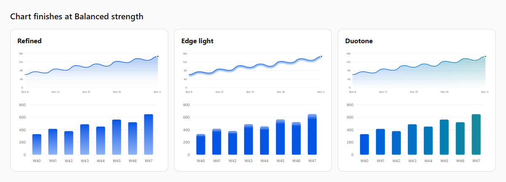

# Gradient chart studies

A local design exploration for the next UIx chart treatment. Open `index.html` directly in a browser, or serve the repository and visit `/packages/tokens/mockups/gradient-charts/`.

The page opens with the **Original** finish at **Balanced** strength in blue. **Refined** uses a solid trend line, a shorter fade, and a stronger color at the top of each bar. **Edge light** follows the trend contour, bar caps, and outer ring. **Duotone** carries a second hue across each time series and uses a smaller shift within each ring segment.

The brief: show a restrained use of gradients in four familiar chart forms, using UIx's existing typography, chart palette, surfaces, chart cards, buttons, and segmented controls. Compare blue, teal, and orchid palettes, three gradient strengths, light/dark themes, and the same geometry rendered flat. All numbers are explicitly illustrative fixtures; there is no service, tracking, or persistence. This is a mockup, not a package API change.

Acceptance: controls update the charts in place; flat mode preserves values and geometry; visible legends and data tables supplement colour; time-series and bar values can be inspected with pointer or keyboard; the page fits desktop and 320 px layouts in both themes. Check contrast, clipping, keyboard interaction, and script errors in a real browser. Primary risks are low-contrast fades and small-screen chart labels, so marks retain solid edges and narrow charts use a readable minimum plot width inside a labelled scroller.

The studies:

- **Soft fill:** a solid trend line above a translucent area that disappears into the surface.
- **Satin bars:** a vertical hue shift, with the top edge retaining the exact value.
- **Chromatic ring:** gradients within each categorical segment, with explicit counts and percentages.
- **Layered comparison:** a restrained current-period wash against a neutral, solid previous-period line.

Tab to an inspectable chart and use Left/Right, Home/End, or Escape. Expand **View sample data** for exact values. With JavaScript disabled, the data tables remain available. No motion is added; all changes are immediate. For forced-colour displays the charts defer to system colours and the tables retain the values.

These files stay separate from the shipped component styles and generated tokens. Choosing a treatment for the production ECharts adapter is a later step.

Verified all 144 finish, palette, strength, theme, and flat combinations in Microsoft Edge. Each finish produces a distinct image in each of the four plots. At Balanced blue, flat mode produces identical chart pixels across finishes in each theme. Keyboard selection and inspection work, and controls fit widths down to 320 px. Eight axe scans of the finishes in light and dark reported zero violations and flagged 38 SVG labels for manual contrast review. Those labels sit on the solid card surface and measured at least 5.33:1 in light and 7.31:1 in dark.
